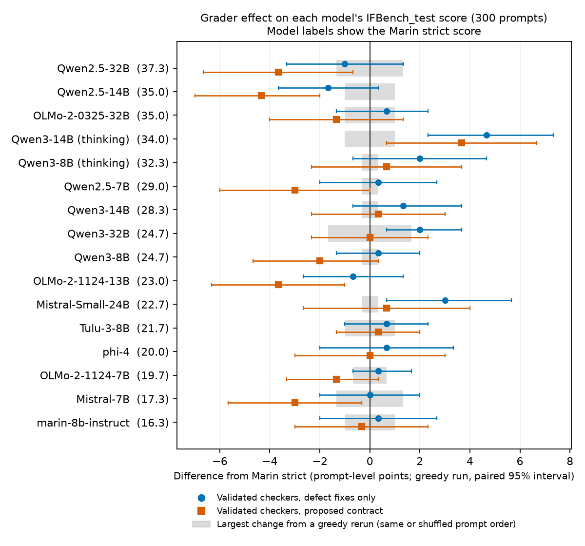

# IFBench checker audit

<a href="LICENSE">
    
</a>

An audit of the 58 IFBench instruction checkers that [Marin](https://github.com/marin-community/marin)
runs through its Evalchemy fork, for [marin-community/marin#10060](https://github.com/marin-community/marin/issues/10060).
It compares each checker with the instruction text the model sees, provides validated checkers that
implement that text, and measures the effect on a panel of open models.

The report is [`reports/AUDIT.md`](reports/AUDIT.md). The proposed protocol for validated contracts is
[`protocol/PROTOCOL.md`](protocol/PROTOCOL.md).

## Results

- 43 checker findings. In Marin's checkers, 37 of the 58 instruction types have at least one
  unambiguous defect, and those types carry 200 of the 344 test constraints. 31 of the 37 are still
  defective on upstream IFBench main. Each finding has a minimal fixture that reproduces it.
- Validated checkers for all 58 types. They pass 143 instruction-labeled fixtures, apart from two
  documented tagger limitations, and agree with upstream's unit tests except at five documented
  assertions. They pass 10 property tests, 8 of which Marin's checkers fail. In fixes-only mode,
  they differ from Marin strict only where a defect is fixed.
- A blinded audit, one condition of the decision gate in the issue's plan. On a held-out round
  (responses not used to develop the checkers), Marin strict contradicts the consensus of two
  separately run LLM reviewers (Claude Opus 5.5 at max effort) on an estimated 6.1% of constraint
  verdicts, and the validated checkers (fixes only) on 3.2%.
- A model panel of 16 configurations of 14 open models (7B–32B), with 68,400 responses graded by
  every grader. Fixing the defects moves a model's prompt-level score by −1.7 to +4.7 points (−1.7
  to +3.0 with thinking off). Used as a reward, Marin strict is wrong on 5.7% of the constraint
  passes it gives, taking the validated verdict (fixes only) as correct. Rerunning the same greedy
  decode moves a Marin strict score by up to 1.3 points.



## Layout

| Path | Contents |
|---|---|
| [`reports/`](reports/) | The audit report and its figures |
| [`protocol/`](protocol/) | The protocol draft, the instruction taxonomy, the input manifest and the adjudication guide |
| [`src/ifbench_audit/`](src/ifbench_audit/) | The validated checkers (`contracts.py`), the shared word and sentence rules (`text_units.py`), a reimplementation of Evalchemy's strict and loose grading (`official.py`), the fixtures and the usefulness diagnostics |
| [`fixtures/`](fixtures/) | The 143 fixtures as JSONL, each with a stable id (task family plus content hash) |
| [`tests/`](tests/) | Fixture regression tests, and property and metamorphic tests |
| [`analysis/`](analysis/) | The scripts behind every number in the report |
| [`results/`](results/) | Their outputs, the panel adjudication record and the blinded audit |
| [`vendor/`](vendor/) | Byte-for-byte copies of Marin's and upstream's checkers, with hashes and provenance |
| [`scripts/`](scripts/) | Fetch the pinned inputs, and reproduce the results from a clean copy |

## Setup

```bash
uv venv --python 3.12
uv pip install -e ".[test]"          # add ",figures" to draw the figures
python scripts/fetch_data.py         # data/: IFBench_test 2e8a48de, upstream's sample responses and tests
python scripts/fetch_nltk_data.py    # nltk_data/: punkt_tab, punkt, stopwords and the tagger, checked by hash
python -m pytest -q                  # 438 passed, 2 xfailed
```

The grader dependencies follow Evalchemy's lock: nltk 3.10.0, emoji 2.15.0, syllapy 0.8.0. Set
`IFBENCH_AUDIT_NLTK_DATA` to use NLTK data from another directory.

## Reproducing the results

The commands below use `P=data/ifbench_test/train-00000-of-00001.parquet` and
`S=data/ifbench/sample_output.jsonl`.

`bash scripts/clean_install_check.sh <empty dir> gen_final.tgz` reruns the tests in a fresh copy,
together with every command below that needs no GPU and no git clone except `open_questions.py`,
`power.py`, `manifest.py` and `figures.py`, and compares each output with the committed one.
`gen_final.tgz` is the release archive described under Model panel. The script's last run is in
[`results/clean_install.txt`](results/clean_install.txt).

### Checkers and fixtures

```bash
python -I analysis/run_cases.py > results/fixtures_matrix.txt
python -I analysis/description_consistency.py $P > results/description_consistency.txt
python -I analysis/upstream_tests_on_validated.py data/ifbench/instructions_test.py > results/upstream_tests_on_validated.txt
python -I analysis/rescore.py $P $S results/upstream_sample_output > results/upstream_sample_output.summary.txt
python -I analysis/loose_rescues.py $P $S > results/loose_rescues.txt
python -I analysis/properties_on_official.py > results/properties_on_official.txt
python -I analysis/fuzz_crashes.py $P 400 > results/fuzz_crashes.txt
python -I analysis/fuzz_csv.py > results/fuzz_csv.txt
python -I analysis/start_verb_eval.py > results/start_verb_eval.txt
python -I analysis/coverage.py $P > results/coverage.txt
python -I analysis/export_fixtures.py
python -I analysis/taxonomy.py $P protocol/taxonomy.md
```

### Model panel

The panel was generated on one NVIDIA H100 80GB GPU with vLLM 0.30.0:

```bash
bash analysis/generate_panel.sh $P results/panel/gen
```

The generations are not in git. Release
[v0.1](https://github.com/XiaoyuanWang111/ifbench-audit/releases/tag/v0.1) has them as
`gen_final.tgz` (53 MB, sha256 `5c5486b95565a76a341b18b8ad353d76ca166a04453114c410abe03f0723c2c8`),
split into six parts. The archive holds 69,000 response lines; the analysis grades 68,400 of them
and leaves out the two incomplete thinking sample runs.

```bash
cat gen_final.tgz.part0* > gen_final.tgz && sha256sum -c SHA256SUMS.txt
tar -xzf gen_final.tgz -C results/panel                # results/panel/gen/<model>/<run>.jsonl
python -I analysis/panel_analysis.py $P results/panel/gen results/panel/analysis > results/panel/analysis.txt
python -I analysis/panel_report.py results/panel/analysis.json > results/panel/report_tables.md
python -I analysis/disagreement_table.py results/panel/analysis.constraints.jsonl > results/panel/disagreements.md
python -I analysis/open_questions.py $P $S results/panel/gen > results/open_questions.txt
python -I analysis/power.py results/panel/analysis.constraints.jsonl $P > results/power.txt
python -I analysis/manifest.py $P results/panel/gen protocol/manifest.json
```

The harness-fidelity check and the provenance record need git clones of `marin-community/marin`,
`marin-community/evalchemy` and `allenai/IFBench`:

```bash
for c in 97fffeb 28631c7; do
  python -I analysis/harness_fidelity.py <evalchemy clone> $c $P $S results/panel/gen
done > results/harness_fidelity.txt
python -I analysis/provenance.py <marin clone> <evalchemy clone> <IFBench clone>
```

### Comparing two checkpoints

`analysis/compare_runs.py` reads two `{"prompt", "response"}` files, the format that Evalchemy and
upstream IFBench write. It reports the paired difference under every grader, so that a score change
can be traced to the model or to the measurement. For example, with two panel configurations:

```bash
python -I analysis/panel_to_responses.py $P results/panel/gen/Qwen__Qwen2.5-14B-Instruct/greedy.jsonl a.jsonl
python -I analysis/panel_to_responses.py $P results/panel/gen/Qwen__Qwen3-14B__thinking/greedy.jsonl b.jsonl
python -I analysis/compare_runs.py $P a.jsonl b.jsonl Qwen2.5-14B Qwen3-14B-think
```

### Blinded audit

[`results/blind_audit/`](results/blind_audit/) holds the frozen samples, keys, reviews and scores,
and its README describes the protocol. To rescore round 2:

```bash
python -I analysis/blind_audit_compare.py results/blind_audit/round2/key.jsonl results/blind_audit/round2/reviews \
    results/blind_audit/round2/score_frozen 259 4409
```

### Figures

```bash
python -I analysis/figures.py results/panel/analysis.json results/panel/analysis.constraints.jsonl reports/figures \
    "Round 1\n(greedy, 564 cases)=results/blind_audit/round1/score_frozen.json" \
    "Round 2, held out\n(sampled run, 200)=results/blind_audit/round2/score_frozen.json"
```

## Status

This is a draft for discussion on [#10060](https://github.com/marin-community/marin/issues/10060).
The interpretation questions in the report's decision table are for the Marin maintainers to decide.

## License

The code and documents are released under the [Apache 2.0 license](LICENSE). The vendored IFBench
files keep their own Apache 2.0 headers. `allenai/IFBench_test` is under ODC-BY-1.0, and the model
responses in the release archive and the blinded-audit cases are subject to each model's license
(see [`vendor/README.md`](vendor/README.md)).
