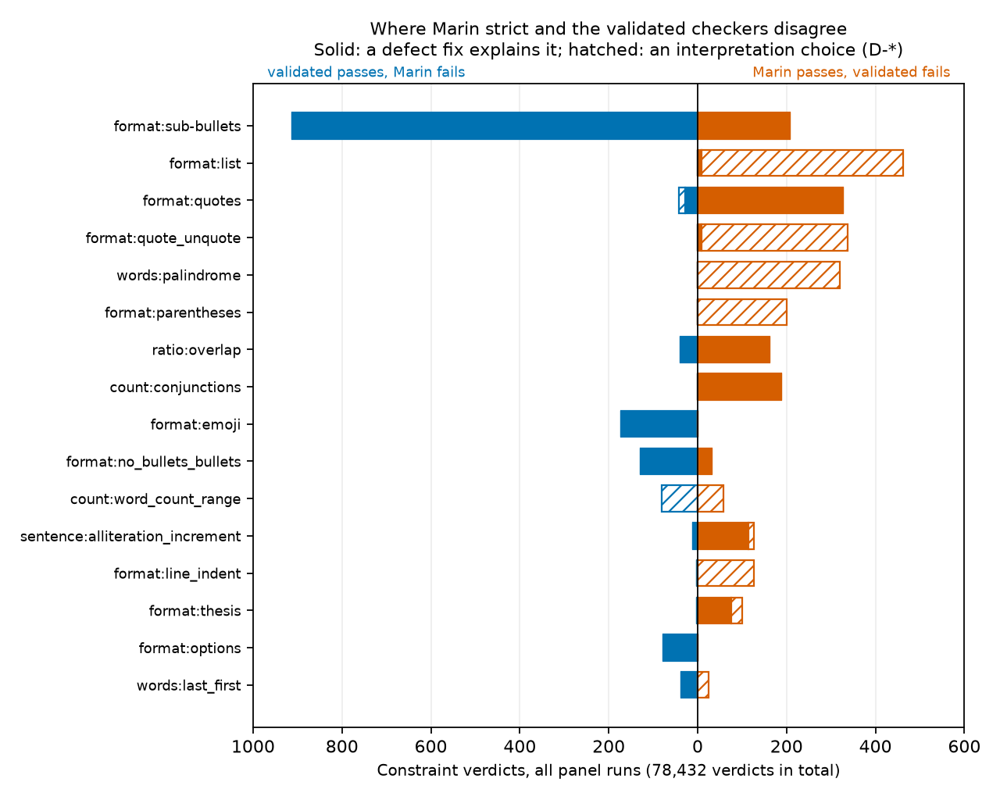
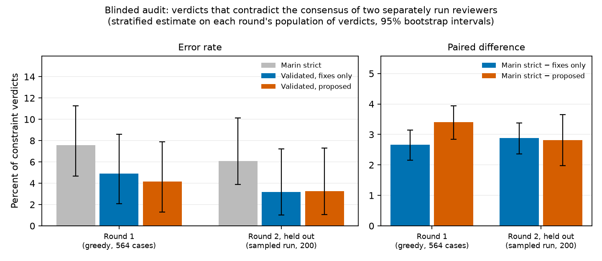

# IFBench checker audit

This report audits the instruction checkers that Marin uses to score IFBench, for
[marin-community/marin#10060](https://github.com/marin-community/marin/issues/10060).
[IFBench](https://github.com/allenai/IFBench) ([Pyatkin et al., 2025](https://arxiv.org/abs/2507.02833))
attaches one or more output constraints to each prompt and runs one checker per constraint. Strict
grading checks the response as written. Loose grading, inherited from
[IFEval](https://arxiv.org/abs/2311.07911), also checks the response with every `*` removed and with
its first line, its last line or both dropped, and passes a constraint if any variant passes.
Marin's eval policy ([#10197](https://github.com/marin-community/marin/issues/10197)) reports
IFBench strict prompt-level accuracy from one sample per prompt, with thinking off.

Draft of 2026-10-17. The [README](../README.md) lists the commands that reproduce every number.

Terms used throughout:
- Marin's checkers are the IFBench checker files in Marin's Evalchemy fork. They were added in
  evalchemy#23 (`ab7ae27`, 2026-08-05) and are unchanged through `28631c7` (2026-10-16), the commit
  Marin's main branch pinned when this report was written. Upstream's checkers are `allenai/IFBench`
  main at `1c40f0c` (2026-09-09).
- The official reading of an instruction is what Marin's and upstream's checker code does with it.
- The validated checkers (`src/ifbench_audit/contracts.py`) implement the instruction text the model
  sees. They run in two modes. Fixes only sets each of the 13 interpretation switches to the official
  reading, so each difference from Marin's checkers is a defect fix. Proposed uses the readings this
  report proposes.
- The six graders are Marin strict, Marin loose, upstream strict, upstream loose, fixes only and
  proposed.
- A constraint verdict is the pass or fail of one constraint on one response. Prompt-level accuracy
  is the share of prompts whose constraints all pass. A contract label is the verdict that the
  instruction text implies. #10060 calls Marin's checkers the frozen checker and a validated
  implementation the replacement.
- Keys are the dataset's `key` column, which is the row index. The task numbers in #10060 are keys.

## TL;DR

In Marin's checkers, 37 of the 58 instruction types have at least one unambiguous defect. Those types
carry 200 of the 344 test constraints, and 31 of the 37 are still defective on upstream main. The
worst defects fail every correct `repeat:repeat_span` answer, pass `format:sub-bullets` responses
that contain no bullets, and end the IFBench evaluation on an empty CSV field (no panel response hit
this one). Validated checkers for all 58 types pass 143 fixtures labeled from the instruction text,
apart from two documented tagger limitations.

The decision gate in the plan posted on #10060 includes a blinded review: the replacement must
contradict the reviewers on fewer contract labels than the frozen checker. On a held-out round
(responses not used to develop the checkers, scored with the checkers frozen after round 1's fixes),
Marin strict contradicts the consensus of two separately run LLM reviewers on 6.1% of constraint
verdicts, and the validated checkers (fixes only) on 3.2%. The paired difference is +2.9 points
[+2.4, +3.4]. Both reviewers are the same model, Claude Opus 5.5 at max effort, and may share blind
spots.

On 16 open-model configurations (7B–32B, 68,400 responses), fixing the defects moves a model's
greedy prompt-level accuracy by −1.7 to +4.7 points, or −1.7 to +3.0 with thinking off. With
thinking on, Qwen3-14B moves from fourth to first, although with the fixes alone no swap's paired
interval excludes zero. Used as a reward, Marin strict is wrong on 5.7% of the constraint passes it
gives, taking the fixes-only verdict as correct. A rerun of the same greedy decode with default vLLM
kernels moves Marin strict accuracy by up to 1.3 points, as much as the 82-to-78 loose difference
between the Recovery baseline and run `.2` in #10043.

## Versions and provenance

| Component | Version | Notes |
|---|---|---|
| Marin's checkers | Evalchemy `ab7ae27` (2026-08-05) to `28631c7` (2026-10-16) | The three checker files have the same bytes at every commit in this range, including `97fffeb`, the commit the issue audited. `eval/chat_benchmarks/IFBench/instructions.py` equals upstream `357d098` (2026-05-13) apart from one import line |
| Evalchemy grading | `97fffeb` and `28631c7` | After [evalchemy#212](https://github.com/marin-community/evalchemy/pull/212) (2026-10-16), IFBench runs through the EvalSpec runtime and `eval/graders/instructions.py`. The strict and loose functions in `grader.py` are unchanged |
| Upstream's checkers | `1c40f0c` (2026-09-09) | Includes `1d62c1d` (Jasper Lu, 2026-07-16, merged 2026-08-30), which fixes six verifiers |
| Test data | `allenai/IFBench_test` `2e8a48de` (2025-10-17, head of main) | Parquet sha256 `80037e4d…7c6a`, pinned by `scripts/fetch_data.py`. Evalchemy names the dataset without a revision |
| Grader dependencies | nltk 3.10.0, emoji 2.15.0, syllapy 0.8.0 | Evalchemy's lock at `97fffeb` and `28631c7` |
| NLTK data | fetched 2026-10-16, pinned by hash | `punkt_tab` sha256 `e57f6418…`, `punkt` `51c30789…`, `stopwords` `48c0e52d…` (198 English words), `averaged_perceptron_tagger_eng` `6025f530…`. `scripts/fetch_nltk_data.py` rejects any other bytes. NLTK data has no version, and the official checkers download missing data at import time |
| Panel generation | vLLM 0.30.0 on one NVIDIA H100 80GB | `protocol/manifest.json` lists model revisions, sampling settings, seeds and per-run timings. The two thinking configurations have no timings because their processes were stopped before they wrote a manifest |

`vendor/` holds byte-for-byte copies of both checker versions, with hashes in `vendor/README.md`.
`vendor/PROVENANCE.md`, generated from git clones by `analysis/provenance.py`, records the evidence
for this table: Marin's pin, the commit dates and authors, the checker blobs at each Evalchemy
commit, the one-line import difference from upstream `357d098`, the merge that brought `1d62c1d`
into upstream main (allenai/IFBench PR #34), the lock contents and how Evalchemy names the dataset.

## Method

1. We compare each checker with the instruction text the model sees. For each of the 344
   (prompt, constraint) pairs, `analysis/description_consistency.py` checks that the prompt contains
   the text the checker itself generates (`results/description_consistency.txt`). All differences
   are cosmetic ("in your response", ordinal suffixes) except three. In Marin's checkers,
   `repeat:repeat_span` says "character indices" while its four prompts say "word indices" (F1). Key 100
   lacks "Do not give any explanation" (G3). Key 8 shows "4.0" where the checker writes "4" (G4).
2. We read all 58 `check_following` implementations and the shared helpers. Sentences come from
   NLTK Punkt, and word counts from `\w+`.
3. Each defect gets a minimal fixture, and correct behavior gets controls: 143 fixtures, 81 defect
   cases and 62 controls. The instruction text alone decides each label. A case whose label depends
   on a reading the text leaves open carries a decision id (see Interpretation decisions).
4. The validated checkers share one definition of word, sentence and line. Each open reading is one
   of 13 switches in `Choices`; `Choices.official()` is the fixes-only mode. Two decisions have no
   switch: the official reading of D-minor-words is itself defect F25, and the official reading of
   D-thesis-body agrees with the proposal.
5. We test the validated checkers and the grading harness:
   - upstream's unit tests, run unchanged, agree with the validated checkers except at five
     assertions, each explained by a finding or a decision (`results/upstream_tests_on_validated.txt`);
   - Hypothesis property tests, whose oracles come from the generated input (for example, brackets
     nested to a known depth), and metamorphic tests that irrelevant edits never change a verdict.
     All 10 property tests pass on the validated checkers, and 8 fail on Marin's
     (`results/properties_on_official.txt`);
   - crash fuzzing: no grader crashes on 400 random texts per instruction id
     (`results/fuzz_crashes.txt`), and structured CSV outputs make both official versions of
     `custom:csv_quotes` crash (F15, `results/fuzz_csv.txt`);
   - harness fidelity: `src/ifbench_audit/official.py` reimplements Evalchemy's strict and loose
     grading, and `analysis/harness_fidelity.py` compares it with Evalchemy's `grader.py`, with
     keyword arguments typed as Arrow delivers them (`results/harness_fidelity.txt`).
6. We rescore upstream's sample responses with every grader and read every disagreement.
7. We generate a panel of 16 configurations of 14 open models under fixed settings, with repeated
   greedy, batch-invariant and sampled runs, and grade it with every grader. We read the panel's
   disagreements in five rounds (`results/panel_adjudication.md`). Each error found in the validated
   checkers was fixed and given a fixture before the panel was regraded.
8. Two blinded review rounds score the checkers on samples frozen before review (see Blinded audit).

## Findings

In Marin's checkers, 37 of the 58 instruction types have at least one unambiguous defect. They carry
200 of the 344 test constraints, in 190 of the 300 prompts. Upstream fixed six of the findings in
`1d62c1d`, and 31 types (168 constraints) are still defective on upstream main. Another 7 types (55
constraints) have only interpretation questions (`results/coverage.txt`). Nine findings rest on a
decision rather than on the instruction text alone: F5, F29, F31, F33–F36, F41 and F42, whose rows
name the decision. These counts leave them out.

The most severe defects, each of which misgrades a whole class of answers or stops the evaluation:
- F1: `repeat:repeat_span` slices characters in Marin's checkers, although all four prompts say "the
  indices are word indices". Every correct answer fails.
- F3: `format:sub-bullets` passes any response without bullets, and loose grading passes every
  response (G1).
- F15: `custom:csv_quotes` raises `IndexError` on an empty field, which aborts the IFBench
  evaluation (G6). It happens on 251 of 3,000 random tab-separated outputs with the required header.
  No panel response triggered it.
- G2: key 105 cannot be satisfied under strict grading by either official version.
- F14: the `custom:european_capitals_sort` reference omits Kyiv, so the factually correct answer
  fails.
- F43: a numbered list whose items each end in an emoji fails `format:emoji`, because Punkt reads
  "1." as a sentence. On the panel, Marin strict fails 146 format:emoji verdicts this way that the
  validated checkers pass.

In the table, *n* is the number of IFBench_test constraints of that type, and the last two columns
give the status in Marin's and upstream's checkers. Fixture names are in
`src/ifbench_audit/fixtures.py`. The static audit found F1–F38, reading the panel's disagreements
found F39–F42, and the blinded audit found F43.

| ID | Instruction (*n*) | Defect | Minimal counterexample | Marin | Upstream |
|---|---|---|---|---|---|
| F1 | repeat:repeat_span (4) | Slices character indices; every prompt says word indices | Key 284: the correct "code and theory behind" fails; "lain" passes | ✗ | fixed |
| F2 | ratio:overlap (12) | Character trigrams instead of word trigrams; the verdict also flips on an appended newline | Shuffled words with 0% word-trigram overlap fail a 0% target | ✗ | fixed |
| F3 | format:sub-bullets (12) | Splits on every `*`: no bullets passes; a hyphen anywhere counts as a sub-bullet; bold text inside a bullet fails | "Plain prose" passes; `* **Rivers**` / `  - Nile` fails | ✗ | ✗ |
| F4 | format:list (9) | With sep `-`, hyphens inside words count as markers. Markers count anywhere in the text; whether each must start a line (keys 83/84) is decision D-list-layout | With sep `-`, "well-known, up-to-date" passes; "a !?!? b !?!? c" passes (D-list-layout) | ✗ | ✗ |
| F5 | format:parentheses (8) | Returns at the first close after depth 5, so inner levels need not close (keys 106/111). The checker's docstring asks for "a correctly closed set"; decision D-balanced-nesting | `((((( x )` passes | ✗ | ✗ |
| F6 | ratio:sentence_words (7) | "Using all different words" is not checked | "I am here." three times passes | ✗ | fixed |
| F7 | count:keywords_multiple (5) | Substring counting ("door" in "doorway") | Exact counts with one "doorway" fail | ✗ | fixed |
| F8 | words:words_position (3) | Punctuation tokens count as words | "Hello, vibrant world, vibrant day." fails | ✗ | fixed |
| F9 | custom:sentence_alphabet (1) | A sentence that opens with a quote fails | `"Ants move."` as sentence one fails | ✗ | fixed |
| F10 | format:thesis (9) | `<em>` and `</em>` are sliced with `<i>` lengths, so an empty `<em>` thesis passes and `<em>T</em>` alone passes where `<i>T</i>` alone fails (D-thesis-body). Only the first italic span is checked, anywhere in the text (key 138) | `<em></em> body text` passes; two headed sections with one thesis pass | ✗ | ✗ |
| F11 | format:quote_unquote (5) | The curly-quote normalization `replace('"', '"')` does nothing (keys 115/117). Guillemets are never recognized, although key 115 quotes Spanish text with « » | `“hi”“there”` and "La película es «Dune»" pass | ✗ | ✗ |
| F12 | format:quotes (8) | Apostrophes count as single quotes (keys 123/124) | `"Don't "x" won't"` passes (two levels plus apostrophes) | ✗ | ✗ |
| F13 | count:conjunctions (7) | The set is built from raw tokens, so "and", "And" and "and," are three conjunctions | "Cats and dogs. And birds and, sadly, fish." passes *n*=3 | ✗ | ✗ |
| F14 | custom:european_capitals_sort (1) | The reference list omits Kyiv (50.45 N) | The correct 28-city list fails; the 27-city list passes | ✗ | ✗ |
| F15 | custom:csv_quotes (1) | `field.strip()[0]` on an empty field raises IndexError | 251 of 3,000 random tab-separated outputs with the required header crash; no panel response did | ✗ | ✗ |
| F16 | custom:csv_special_character (1) | Returns at the first quoted special field; later rows are unchecked | Row 9 with four fields passes | ✗ | ✗ |
| F17 | ratio:sentence_type, ratio:sentence_balance (13) | 0:0 counts as 2:1 and 0:0:0 as balanced; `."` endings are not counted | "Wow! Amazing!" passes 2:1 | ✗ | ✗ |
| F18 | sentence:alliteration_increment (5) | Sums all alliterative runs instead of comparing the longest | "Big bears. Cats can, dogs dig." passes | ✗ | ✗ |
| F19 | format:newline (6) | Compares line count with word count; whitespace-only lines count as lines | "a b\n \nc" passes | ✗ | ✗ |
| F20 | format:line_indent (9) | Removes list items while iterating, so two blank lines in a row fail; tabs are ignored | "a\n\n\n  b\n    c" fails | ✗ | ✗ |
| F21 | words:paragraph_last_first (6) | The first word keeps its trailing comma | "Time, they say, waits for no one, not even time." fails | ✗ | ✗ |
| F22 | format:no_bullets_bullets (5) | Any blank line after the bullets fails (including a trailing newline); a blank line between prose lines resets a flag; sentences need not end in a period | "One. Two.\n* a\n* b\n" fails | ✗ | ✗ |
| F23 | repeat:repeat_change (3) | Accepts the request with its first word unchanged if any whitespace differs | The request plus "\n" passes | ✗ | ✗ |
| F24 | format:output_template (4) | Only checks that the three labels occur | Reordered or empty labels pass | ✗ | ✗ |
| F25 | format:title_case (4) | Rejects lowercase minor words, although the prompt says "every major word". NLTK splits "Don't" into "Do" + "n't" | "The Cat and the Hat" fails | ✗ | ✗ |
| F26 | format:options (6) | No whitespace normalization: "b)\n" fails, and key 105 becomes unsatisfiable (G2) | "I\nknow" fails | ✗ | ✗ |
| F27 | format:emoji (9) | Single code-point test: flags and keycaps fail, and an emoji followed by a letter passes | "I love it 🇺🇸" fails; "Smile 😀x" passes | ✗ | ✗ |
| F28 | words:start_verb (6) | The NLTK tagger misses 38 of 213 imperative openings (18%), with no false positives on 39 non-verb openings | "Explore the city at night." (IN) fails | ✗ | ✗ |
| F29 | count:numbers (8) | Removes punctuation first, so "5-7" is one number | decision D-number-boundaries | ✗ | ✗ |
| F30 | count:unique_word_count (9) | Punctuation-only tokens strip to "" and count as a word | "- one two\n- three four" has 5 unique words | ✗ | ✗ |
| F31 | words:consonants (15) | Bullet markers and numbers must contain clusters | decision D-non-word-tokens | ✗ | ✗ |
| F32 | words:prime_lengths (5) | Curly quotes count toward word length | `“Hi”` has length 4 | ✗ | ✗ |
| F33 | count:words_japanese (5) | Passes when the response has fewer than N words | decision D-vacuous | ✗ | ✗ |
| F34 | words:last_first, words:paragraph_last_first, sentence:increment, format:line_indent (28) | One sentence, one line or one-word paragraphs pass vacuously; loose grading makes this reachable from longer answers (G1) | decision D-vacuous | ✗ | ✗ |
| F35 | words:palindrome (7) | Counts occurrences of any token (key 234) | decision D-distinct-palindromes; upstream's own test accepts "abcba" ten times | ✗ | ✗ |
| F36 | words:keywords_specific_position (4) | NLTK splits contractions, which shifts word positions | decision D-word-tokens | ✗ | ✗ |
| F37 | custom:date_format_list (1) | Accepts month 00, day 00 and 1801-02-29 | "1805-12-02, 1800-00-00" passes | ✗ | ✗ |
| F38 | custom:reverse_newline, custom:word_reverse, custom:character_reverse (3) | Content is never checked: any 52 sorted lines after "Zimbabwe" pass, and the forward answer may accompany the reversed one | Upstream's own positive fixture omits Ethiopia and The Gambia | ✗ | ✗ |
| F39 | custom:mcq_count_length (1) | Splits questions only on "Question" followed by a number, although the prompt asks only for the label "Question". Any text before the first label, even one space, counts as an explanation | Four questions labeled "Question:" count as one; a leading space fails | ✗ | ✗ |
| F40 | words:last_first (5) | The next sentence's first word keeps its trailing comma (as in F21) | "…extreme conditions. Conditions, such as…" fails | ✗ | ✗ |
| F41 | words:start_verb (6) | A leading heading marker, quote mark or HTML tag is read as the first word | decision D-non-word-tokens; "### Consider the cost" fails | ✗ | ✗ |
| F42 | words:words_position (3) | List numbers count as words, so "1." shifts every position (upstream's F8 fix removes only punctuation tokens) | decision D-non-word-tokens; "1. Colors vibrant fill a vibrant room." fails | ✗ | ✗ |
| F43 | format:emoji, sentence:keyword (24) | Punkt reads a list label ("1.") as a sentence of its own | "1. Plant a tree. 🌳 / 2. Water it daily. 💧" fails; in "1. Cats purr. / 2. Dogs bark. / 3. Owls hoot." the third sentence is "2." | ✗ | ✗ |

## Interpretation decisions

The instruction text leaves the questions below open. The proposed mode implements the proposal, and
fixes only reproduces the official reading. A contested case is a blinded case where Marin strict
and proposed disagree because of that decision; the table counts the reviewers' verdicts on these
cases over both rounds.

| ID | Question | Official reading | Proposal |
|---|---|---|---|
| D-vacuous | Does a constraint on sentences, lines or quotes hold when the structure is absent (one sentence, one line, no quoted phrase, fewer than N words)? | Yes | No. The instruction asks for the structure, and loose grading turns vacuous passes into free passes (G1). Upstream's test expects "123..." to pass format:quote_unquote. The blinded reviewers read an absent structure as satisfied: in format:quote_unquote responses with no quoted phrase, they took the official side in 29 of 31 contested cases |
| D-distinct-palindromes | In words:palindrome, are ten palindromes ten occurrences or ten different words? Must they be alphabetic? | Occurrences, any token | Ten different alphabetic words (key 234). Upstream's own test expects "abcba" ×10 to pass, so this needs a maintainer decision. The reviewers sided with the proposal in all 37 cases |
| D-number-boundaries | In count:numbers, is "5-7" one number or two? | One (punctuation is removed first) | Two; only "." or "," between digits continues a number (3.14, 100,000) |
| D-non-word-tokens | Are bullet markers, numbers, emoji and leading markup (`###`, quote marks, HTML tags) words? | Yes, for words:consonants, words:prime_lengths, words:odd_even_syllables, words:start_verb and words:words_position | No. A word contains a letter, and markup before the first word is formatting |
| D-word-tokens | Do word counts and positions use whitespace words or `\w+` and NLTK tokens? | `\w+` for counts, NLTK for positions ("don't" is two) | Words are separated by whitespace or a dash (— – --), with outer punctuation removed. "don't" and "well-known" are one word; "information—no" is two |
| D-curly-quotes | Do typographic quotes nest in format:quotes? | No | Yes. For format:quote_unquote, curly quotes are a defect fix, since the code meant to normalize them |
| D-explanation-word | In format:quote_unquote, is a comma an "unquoted explanation"? | Any non-space text is | The text after a quote must contain a word. None of the 3 contested cases has a reviewer consensus for the official reading |
| D-tabs | In format:line_indent, do tabs indent? | No | Yes, four columns |
| D-minor-words | In format:title_case, which words may stay lowercase? | None (that is F25) | Articles, coordinating conjunctions and prepositions of up to four letters. Both modes use this list, because the official reading is the defect |
| D-section | What is a section in format:thesis? | Not modeled | Markdown headings, HTML headings and lines of only bold text delimit sections; without them, the response is one section. Text before the first heading counts as a section, and horizontal rules do not delimit sections. In three phi-4 responses the reviewers read it the other way: a one-line preamble is not a section, and horizontal rules mark sections |
| D-thesis-body | Must a thesis be followed by text in its section? | Yes for `<i>` (the docstring says "followed by unitalicized text"), but `<em>T</em>` alone passes through F10 | Yes for both tags; no switch. The reviewers accepted a thesis alone (one fixture) |
| D-option-case | In format:options, does "B)" answer the option "b)"? | No | Yes |
| D-code-fence | In the custom:csv_* types, may the CSV sit in one fenced code block? | No | Yes |
| D-list-layout | In format:list, must each marker start a line, in place of a bullet? | Markers count anywhere in the text | Each marker starts a line, as upstream's docstring says ("instances of {sep} that start a new line") and keys 83/84 in the issue expect. The reviewers accepted inline separators: they took the official side in 40 of 52 contested cases. They also failed one response that kept `-` bullets inside its separator items, which neither checker tests |
| D-balanced-nesting | Must all five nested levels close, in order? | No: the check passes at the first matching close once five levels are open | Yes, as the docstring says ("a correctly closed set") and keys 106/111 in the issue expect. The reviewers counted depth without closure: the official side in 17 of 23 contested cases |

Three more questions have no proposal yet. We measured the first two by switching them on the
panel's greedy responses and on upstream's sample responses (`results/open_questions.txt`). The third
rests on one blinded case.
- D-sentences: should a line break end a sentence? Punkt merges unpunctuated lines (G7), including a
  line that ends in a display equation. Compared with proposed, ending sentences at line breaks
  changes 1 of 344 sample verdicts (key 282) and 16 of 5,504 panel verdicts. Punkt also does not
  split after a period that a tag follows directly (`will.
`); removing tags before segmentation
  changes no verdict.
- D-sub-bullet-nesting: must sub-bullets be indented under their bullet? Neither the validated
  checker nor upstream's docstring requires it. Requiring it changes one sample verdict (key 129)
  and 34 panel verdicts. In both contested blinded cases, both reviewers required the nesting.
- Output surface: is a lead-in line ("Multiples of 7 between 10 and 50:") part of the answer? Every
  checker grades the whole visible answer. The blinded reviewers left such a line out in one
  `custom:multiples` case.

## Protocol findings

- G1: loose grading turns vacuous passes into free passes. It checks each constraint against the
  best of its variants. Removing `*` deletes the bullets, so format:sub-bullets passes for any
  response. Dropping lines reduces a three-line answer to one line, which format:line_indent,
  words:last_first and sentence:increment accept. On upstream's sample responses, 15 constraints
  fail strict but pass loose. Six of them are correct format:sub-bullets answers that strict fails
  through F3, and loose passes them only because deleting `*` deletes their bullets. On the panel,
  the validated checkers reject most loose rescues (see Loose rescues). The parent campaign (#10043)
  made loose accuracy its primary instruction-following metric.
- G2: key 105 cannot be satisfied under strict grading. It combines format:options ("I know or I
  don't know") with format:newline ("Write each word on a new line"). "I know" fails newline and
  "I\nknow" fails options, on both official versions, so every model scores 0 on this prompt under
  strict grading. Under loose grading, a response can pass by satisfying each constraint on a
  different variant. One of the panel's 228 responses to key 105 does: phi-4's "I don't know. /
  Naïve." passes options with its last line dropped and newline with its first line dropped. With
  whitespace normalization (F26), "I\nknow" satisfies both.
- G3: key 100 lacks "Do not give any explanation", but the checker still demands an option-only
  answer. The issue treats keys 100 and 103 as genuine model failures. Key 103 carries the clause;
  on key 100, a model that answers "Yes, because …" follows the prompt as written.
- G4: the parquet stores 117 integer arguments as doubles. The value reaches the prompt text in key
  8 ("Use at least 4.0 different coordinating conjunctions"). Checkers receive floats such as
  `small_n=4.0` and `N=5.0`, and none crash on them today.
- G5: two inputs are unpinned. Evalchemy names the dataset without a revision, and the checkers
  download NLTK data, which has no version, at import time.
- G6: one checker exception ends the evaluation. At `97fffeb`, `grader.py` calls `check_following`
  without per-constraint error handling, so F15 aborts the IFBench evaluation. At `28631c7`,
  `eval/graders/instructions.py` calls the same functions, and the runtime raises the exception as a
  grading failure instead of recording it per constraint. We have not tested whether that stops only
  the IFBench task or the whole run.
- G7: Punkt does not split sentences at line breaks. A response written as unpunctuated lines is one
  "sentence", so sentence-level constraints pass vacuously (sample keys 219–222). Punkt also reads a
  list label as a sentence of its own (F43).

## Upstream's sample responses

Upstream's `data/sample_output.jsonl` holds 300 responses from a model the repository does not name.
Every grader scores them (`results/upstream_sample_output.*`).

| Grader | Prompt-level | Instruction-level |
|---|---|---|
| Marin strict | 27.7% | 29.7% |
| Marin loose | 31.0% | 34.0% |
| Upstream strict | 28.0% | 29.7% |
| Upstream loose | 31.3% | 34.0% |
| Fixes only | 29.3% | 31.7% |
| Proposed | 27.0% | 29.4% |

Marin strict and proposed disagree on 21 constraints. We read each one against the instruction text:
13 follow from defect fixes and 8 from proposed readings.
- format:sub-bullets: 6. Bold titles inside bullets made Marin fail correct answers; key 135 also
  writes its sub-bullets as `- - text`.
- words:last_first: 4. Unpunctuated lines collapse into one vacuous sentence (D-vacuous).
- ratio:overlap: 3.
- format:list: 2. Markers mid-line (D-list-layout).
- format:quotes: 2. Apostrophes reached three "levels".
- format:emoji: 1. A numbered list whose items end in emoji (F43).
- format:line_indent: 1. A one-line answer (D-vacuous).
- ratio:sentence_type: 1. A sentence ending in `."`.
- words:palindrome: 1. Five distinct palindromes, repeated (D-distinct-palindromes).

## Model panel

Fixing the defects moves scores by up to 4.7 points and reorders the top of the ranking. Rerunning
the same greedy decode moves them by up to 1.3 points. The analysis is in `results/panel/`
(`analysis.txt`, `report_tables.md`, `disagreements.md`), and the per-response records are in
`analysis.samples.jsonl.gz`.

### Setup

- Models: fourteen open instruction-tuned models from 7B to 32B.
  - Qwen2.5 7B, 14B and 32B;
  - Qwen3 8B, 14B and 32B, with thinking off;
  - Llama-3.1-Tulu-3-8B;
  - OLMo-2 7B, 13B and 32B;
  - marin-8b-instruct;
  - Mistral-7B-Instruct-v0.3 and Mistral-Small-24B-Instruct-2501;
  - phi-4.

  Qwen3-8B and Qwen3-14B also run with thinking on, for 16 configurations.
- Generation: vLLM 0.30.0 on one NVIDIA H100 80GB, with each model's chat template and at most 1,024
  new tokens (8,192 with thinking). `analysis/generate_panel.sh` runs `analysis/generate_vllm.py`
  for every configuration. These settings differ from published IFBench evaluations, so absolute
  scores are not comparable with published numbers. Every grader comparison below uses identical
  responses.
- Runs per model:
  - greedy; greedy again in the same order; greedy in shuffled prompt order;
  - 12 samples at temperature 0.7 (8 for the 24B and 32B models), with seed 10060 + i;
  - greedy twice with vLLM's batch-invariant kernels (`VLLM_BATCH_INVARIANT=1`), once in each order.

  The thinking configurations have the three greedy runs only. Their sampled runs were stopped
  early, and `panel_analysis.py` leaves the incomplete files out.
- Grading: all six graders score every response, 68,400 responses and 78,432 constraint verdicts.

### Scores

These are prompt-level accuracies on the 300 prompts, from the greedy run. Brackets are 95% bootstrap
intervals over prompts, and the differences are paired.

| Model | Marin strict | Marin loose | Upstream strict | Fixes only − Marin | Proposed − Marin | Truncated |
|---|---|---|---|---|---|---|
| Qwen2.5-32B | 37.3 [31.7, 43.3] | 41.3 | 37.0 | −1.0 [−3.3, +1.3] | −3.7 [−6.7, −0.7] | 4.0% |
| Qwen2.5-14B | 35.0 [29.7, 40.7] | 38.3 | 35.3 | −1.7 [−3.7, +0.3] | −4.3 [−7.0, −2.0] | 4.3% |
| OLMo-2-0325-32B | 35.0 [29.7, 40.7] | 39.3 | 35.0 | +0.7 [−1.3, +2.3] | −1.3 [−4.0, +1.3] | 2.0% |
| Qwen3-14B (thinking) | 34.0 [28.7, 39.3] | 39.3 | 34.3 | +4.7 [+2.3, +7.3] | +3.7 [+0.7, +6.7] | 5.3% |
| Qwen3-8B (thinking) | 32.3 [27.0, 37.7] | 35.3 | 32.3 | +2.0 [−0.7, +4.7] | +0.7 [−2.3, +3.7] | 16.3% |
| Qwen2.5-7B | 29.0 [24.0, 34.3] | 32.0 | 29.3 | +0.3 [−2.0, +2.7] | −3.0 [−6.0, +0.0] | 6.7% |
| Qwen3-14B | 28.3 [23.3, 33.7] | 31.7 | 28.3 | +1.3 [−0.7, +3.7] | +0.3 [−2.3, +3.0] | 10.3% |
| Qwen3-32B | 24.7 [20.0, 29.7] | 28.3 | 24.7 | +2.0 [+0.7, +3.7] | +0.0 [−2.3, +2.3] | 10.3% |
| Qwen3-8B | 24.7 [19.7, 29.7] | 29.0 | 24.3 | +0.3 [−1.3, +2.0] | −2.0 [−4.7, +0.3] | 15.0% |
| OLMo-2-1124-13B | 23.0 [18.3, 28.0] | 26.7 | 23.0 | −0.7 [−2.7, +1.3] | −3.7 [−6.3, −1.0] | 1.7% |
| Mistral-Small-24B | 22.7 [18.0, 27.3] | 28.3 | 23.0 | +3.0 [+0.7, +5.7] | +0.7 [−2.7, +4.0] | 9.0% |
| Tulu-3-8B | 21.7 [17.0, 26.3] | 26.3 | 21.7 | +0.7 [−1.0, +2.3] | +0.3 [−1.3, +2.0] | 5.3% |
| phi-4 | 20.0 [16.0, 24.7] | 25.0 | 20.0 | +0.7 [−2.0, +3.3] | +0.0 [−3.0, +3.0] | 4.3% |
| OLMo-2-1124-7B | 19.7 [15.3, 24.0] | 24.0 | 19.7 | +0.3 [−0.7, +1.7] | −1.3 [−3.3, +0.3] | 4.0% |
| Mistral-7B | 17.3 [13.0, 21.7] | 20.0 | 17.3 | +0.0 [−2.0, +2.0] | −3.0 [−5.7, −0.3] | 5.0% |
| marin-8b-instruct | 16.3 [12.3, 20.7] | 20.7 | 16.3 | +0.3 [−2.0, +2.7] | −0.3 [−3.0, +2.3] | 11.3% |

- Upstream strict is within one prompt (0.3 points) of Marin strict for every model, so few panel
  responses reach the six upstream fixes.
- With thinking off, as in Marin's eval policy, fixes only moves a model by −1.7 to +3.0 points.
- Proposed moves a model by −4.3 to +3.7 points. It mostly lowers scores, through D-list-layout,
  D-vacuous, D-distinct-palindromes and D-balanced-nesting.
- Loose grading adds 2.7 to 5.7 points to strict.
- As a reward, Marin strict is wrong on 5.7% (1,227 of 21,708) of the constraint passes it gives and
  on 2.7% (1,548 of 56,724) of the fails, taking the fixes-only verdict as correct
  (`analysis/disagreement_table.py`). The disagreement table below compares Marin strict with
  proposed and splits the verdicts by cause, so it leaves out the few verdicts where a decision
  reverses a fix (1,221 and 1,544 instead of 1,227 and 1,548).

### Rankings

Kendall's tau against Marin strict is 0.85 for fixes only and 0.82 for proposed. The largest changes
are at the top.
- Under Marin strict, the order is Qwen2.5-32B (37.3), then Qwen2.5-14B and OLMo-2-0325-32B (35.0),
  then Qwen3-14B with thinking (34.0).
- With the defects fixed, Qwen3-14B with thinking is first (38.7) and Qwen2.5-14B falls to fifth
  (33.3).
- The largest swap is Qwen2.5-14B against Qwen3-14B with thinking: +1.0 points under Marin strict,
  −5.3 [−11.3, +1.0] with fixes only and −7.0 [−13.3, −1.0] under proposed. Under proposed, it is the
  only swap whose paired interval excludes zero. With fixes only, no swap's interval excludes zero.
- With thinking off, fixes only keeps Qwen2.5-32B first (36.3) and puts OLMo-2-0325-32B (35.7) ahead
  of Qwen2.5-14B (33.3).
- The defect fixes behind the largest swap:
  - Qwen3-14B with thinking gains 15 prompts and loses 1. Nine of the gains are format:sub-bullets
    answers with bold titles inside bullets, which Marin's checker fails (F3).
  - Qwen2.5-14B loses 7 prompts and gains 2. Marin's checkers pass answers that fail
    count:conjunctions (F13), format:no_bullets_bullets (F22), sentence:alliteration_increment (F18)
    and format:sub-bullets (F3).
- Ranked by mean sampled accuracy, over the 14 configurations without thinking, Marin strict and
  proposed agree more closely (tau 0.93).

### Run-to-run variation

Run-to-run variation is the same order of magnitude as the grader effect.

| Model | Identical, same order | Identical, shuffled | Prompt verdicts changed (same order) | Marin strict change (points) | Identical, batch-invariant | Default vs batch-invariant identical |
|---|---|---|---|---|---|---|
| Qwen2.5-32B | 36.0% | 33.0% | 12 | −1.3 | 100.0% | 24.7% |
| Qwen2.5-14B | 67.3% | 67.3% | 5 | −1.0 | 100.0% | 27.0% |
| OLMo-2-0325-32B | 38.3% | 34.0% | 8 | +0.0 | 100.0% | 28.7% |
| Qwen3-14B (thinking) | 52.0% | 48.0% | 5 | +1.0 | – | – |
| Qwen3-8B (thinking) | 43.3% | 46.0% | 10 | +0.0 | – | – |
| Qwen2.5-7B | 30.3% | 34.3% | 9 | −0.3 | 100.0% | 30.3% |
| Qwen3-14B | 55.0% | 53.7% | 3 | −0.3 | 100.0% | 54.0% |
| Qwen3-32B | 28.3% | 24.7% | 16 | −0.7 | 100.0% | 23.7% |
| Qwen3-8B | 49.0% | 50.3% | 4 | +0.0 | 100.0% | 27.0% |
| OLMo-2-1124-13B | 62.7% | 62.7% | 8 | +0.0 | 100.0% | 23.3% |
| Mistral-Small-24B | 59.7% | 32.0% | 3 | −0.3 | 100.0% | 33.0% |
| Tulu-3-8B | 33.3% | 35.3% | 9 | +0.3 | 100.0% | 36.3% |
| phi-4 | 66.0% | 59.7% | 0 | +0.0 | 100.0% | 60.7% |
| OLMo-2-1124-7B | 62.0% | 60.3% | 2 | +0.7 | 100.0% | 26.3% |
| Mistral-7B | 52.3% | 43.0% | 3 | +0.3 | 100.0% | 24.3% |
| marin-8b-instruct | 49.3% | 45.3% | 5 | −1.0 | 100.0% | 37.0% |

- With vLLM's default kernels, greedy decoding is not deterministic. Rerunning the same prompts in
  the same order reproduces 28–67% of the responses exactly, changes up to 16 prompt verdicts
  (Qwen3-32B) and moves Marin strict accuracy by up to 1.3 points. In shuffled order, it moves by up
  to 1.7 points.
- Batch-invariant mode reproduces every response, in either prompt order, at 1.5–2.2 times the
  generation time.
- Across sampled runs, one model's accuracy spans up to 7.0 points (phi-4, 15.3–22.3).
- In #10043, Recovery scored 82 of 300 prompts under loose grading and run `.2` scored 78, a
  1.3-point difference. A default-mode rerun moves a score by as much. Runs `.3` and `.4` scored 79
  and 84, on both sides of Recovery. Attributing such a difference to the model needs repeated
  or batch-invariant runs and a paired interval.

Prompt-level accuracy over the sampled runs (temperature 0.7):

| Model | Runs | Marin strict mean (min–max) | Proposed mean (min–max) |
|---|---|---|---|
| Qwen2.5-32B | 8 | 34.3 (31.3–36.7) | 31.8 (29.7–33.0) |
| Qwen2.5-14B | 12 | 33.9 (30.7–37.0) | 31.2 (29.0–34.3) |
| OLMo-2-0325-32B | 8 | 32.7 (30.0–35.0) | 31.1 (29.0–32.3) |
| Qwen2.5-7B | 12 | 26.8 (24.7–29.3) | 23.9 (22.3–26.0) |
| Qwen3-14B | 12 | 27.7 (25.7–30.0) | 27.7 (25.7–30.0) |
| Qwen3-32B | 8 | 25.6 (23.3–29.7) | 25.3 (22.0–28.3) |
| Qwen3-8B | 12 | 25.5 (23.0–27.7) | 23.5 (21.7–25.7) |
| OLMo-2-1124-13B | 12 | 22.3 (19.3–24.3) | 20.3 (18.0–22.3) |
| Mistral-Small-24B | 8 | 21.0 (19.3–23.3) | 21.8 (20.7–23.7) |
| Tulu-3-8B | 12 | 22.8 (20.3–24.7) | 22.8 (21.0–24.7) |
| phi-4 | 12 | 18.7 (15.3–22.3) | 19.2 (16.3–23.0) |
| OLMo-2-1124-7B | 12 | 20.4 (19.0–21.7) | 19.1 (18.0–20.7) |
| Mistral-7B | 12 | 17.6 (15.3–19.7) | 15.3 (13.7–17.0) |
| marin-8b-instruct | 12 | 17.9 (16.0–19.7) | 16.5 (14.3–19.3) |

### Thinking configurations

Grading the raw text, reasoning included, costs a thinking model 13–14 points: Qwen3-8B scores 19.3
instead of 32.3 and Qwen3-14B scores 20.0 instead of 34.0 (Marin strict). 11.7% of Qwen3-8B's greedy
responses (3.0% for Qwen3-14B) never close the reasoning within 8,192 tokens, so their visible
"answer" is reasoning text. The tables above grade such a response on its raw text. Counting it as
an extraction failure, as the protocol proposes, would remove 10 Marin strict prompt passes from
Qwen3-8B (3.3 points) and 2 from Qwen3-14B (0.7 points).

### Where the graders disagree

Marin strict and proposed disagree on 4,501 of the 78,432 constraint verdicts. Defect fixes explain
2,765 of them and interpretation choices 1,736. The largest types:

| Instruction | All verdicts | Marin passes, proposed fails: fix | : decision | Proposed passes, Marin fails: fix | : decision |
|---|---|---|---|---|---|
| format:sub-bullets | 2736 | 208 | 0 | 912 | 0 |
| format:list | 2052 | 9 | 454 | 0 | 0 |
| format:quotes | 1824 | 327 | 0 | 28 | 15 |
| format:quote_unquote | 1140 | 9 | 328 | 0 | 0 |
| words:palindrome | 1596 | 0 | 320 | 0 | 0 |
| format:parentheses | 1824 | 0 | 201 | 0 | 0 |
| ratio:overlap | 2736 | 162 | 0 | 39 | 0 |
| count:conjunctions | 1596 | 188 | 0 | 0 | 0 |
| format:emoji | 2052 | 0 | 0 | 173 | 0 |
| format:no_bullets_bullets | 1140 | 31 | 0 | 128 | 0 |
| count:word_count_range | 2508 | 0 | 58 | 0 | 80 |
| sentence:alliteration_increment | 1140 | 114 | 13 | 10 | 0 |
| format:line_indent | 2052 | 0 | 126 | 1 | 0 |
| format:thesis | 2052 | 76 | 25 | 2 | 0 |
| all types | 78432 | 1221 | 1629 | 1544 | 107 |

`results/panel_adjudication.md` records the manual adjudication: three cases per instruction and
direction in each round, each read against the instruction text. In every category a defect fix
explains, the validated verdict followed the instruction, apart from errors in the validated
checkers themselves. The manual rounds found F39–F42 and later extended F11 and F39; the blinded
rounds found F43.

### Usefulness diagnostics

The issue asks for a usefulness signal kept apart from compliance. `src/ifbench_audit/diagnostics.py`
records four properties of every response (the table shows the greedy run):
- length;
- truncation (the token limit was reached);
- repetition (the share of repeated 4-grams; a response at or above 0.5 counts as degenerate);
- unclosed reasoning.

| Model | Mean tokens | Truncated | Degenerate | Constraint passes (Marin strict) | of which truncated or degenerate |
|---|---|---|---|---|---|
| Qwen2.5-32B | 289 | 4.0% | 3.0% | 143 | 9 |
| Qwen2.5-14B | 285 | 4.3% | 2.7% | 129 | 5 |
| OLMo-2-0325-32B | 266 | 2.0% | 0.0% | 133 | 1 |
| Qwen3-14B (thinking) | 1654 | 5.3% | 5.0% | 127 | 6 |
| Qwen3-8B (thinking) | 2714 | 16.3% | 15.7% | 123 | 20 |
| Qwen2.5-7B | 287 | 6.7% | 4.0% | 111 | 9 |
| Qwen3-14B | 373 | 10.3% | 3.0% | 109 | 6 |
| Qwen3-32B | 411 | 10.3% | 1.7% | 96 | 8 |
| Qwen3-8B | 428 | 15.0% | 5.7% | 97 | 8 |
| OLMo-2-1124-13B | 369 | 1.7% | 0.0% | 85 | 2 |
| Mistral-Small-24B | 377 | 9.0% | 3.0% | 86 | 6 |
| Tulu-3-8B | 421 | 5.3% | 0.0% | 83 | 6 |
| phi-4 | 420 | 4.3% | 0.3% | 76 | 1 |
| OLMo-2-1124-7B | 390 | 4.0% | 0.0% | 77 | 2 |
| Mistral-7B | 396 | 5.0% | 0.7% | 67 | 4 |
| marin-8b-instruct | 382 | 11.3% | 5.7% | 66 | 7 |

Truncated or degenerate responses still collect constraint passes: 20 of the 123 that Marin strict
gives Qwen3-8B with thinking, and 9 of the 143 it gives Qwen2.5-32B. A reward built on these checkers
alone pays for them.

### Loose rescues

Across all runs, 3,666 constraint verdicts fail strict but pass loose. Proposed accepts 1,014 of
them, 912 of which are format:sub-bullets answers that strict grading fails through F3. It rejects
the rest, which include one-line answers to format:line_indent, word and number counts that come
within range once a line is dropped, and format:sub-bullets answers whose bullets disappear once `*`
is deleted.

## Blinded audit

The issue's decision gate requires blinded review of a preselected sample to find fewer
contract-label errors in the replacement than in the frozen checker. `results/blind_audit/` holds
the full record: the frozen samples and their hashes, the keys, every batch and review, and the
scores.

- Each sample is frozen and hashed before review. It holds panel disagreements between Marin strict
  and proposed (as frozen), random panel agreements, and in round 1 every fixture.
- Two reviewers, run separately, label every case. They are LLM agents running Claude Opus 5.5 at
  max effort. Round 2 ran entirely on Opus 5.5. In four round-1 reviews, earlier Claude models
  served some of the reviewer's model calls; the record's README lists them. A reviewer sees an
  opaque case id, the instruction id and text, the prompt and the response, never the model or a
  verdict.
- For each case, a reviewer gives pass, fail or ambiguous, plus a lean: the verdict under the
  reading the reviewer finds most natural. A case has a consensus label when the two leans agree.
- The error rate is the share of the population's constraint verdicts that contradict the consensus.
  It is estimated by stratum (disagreements, agreements), with 95% bootstrap intervals.

Round 1 reviewed all 328 greedy disagreements, 100 agreements and all 136 fixtures, with the
checkers as they were then. Round 2 was frozen after the fixes that round 1 prompted. It drew 150 of
259 disagreements and 50 of 4,409 agreements from the first sampled run, leaving out every response
identical to the same configuration's greedy response.

| | Round 1 (greedy) | Round 2 (held out) |
|---|---|---|
| Cases labeled by both reviewers | 564 | 200 |
| Leans agree; Cohen's kappa | 97.0%; 0.94 | 98.0%; 0.96 |
| Fixture labels confirmed by the consensus | 125 of 131 | – |
| Fix-driven disagreements: consensus with validated / Marin / disputed | 192 / 50 / 7 | 81 / 5 / 1 |
| Decision-driven disagreements: same | 58 / 18 / 3 | 29 / 31 / 3 |
| Error rate: Marin strict | 7.6% [4.7, 11.3] | 6.1% [3.9, 10.1] |
| Error rate: fixes only | 4.9% [2.1, 8.6] | 3.2% [1.0, 7.2] |
| Error rate: proposed | 4.2% [1.3, 7.9] | 3.3% [1.1, 7.3] |
| Marin strict − fixes only (points) | +2.7 [+2.2, +3.1] | +2.9 [+2.4, +3.4] |
| Marin strict − proposed (points) | +3.4 [+2.8, +3.9] | +2.8 [+2.0, +3.6] |

- Both rounds meet the gate's blinded-review condition: fixes only and proposed each contradict the
  consensus less often than Marin strict, and each paired 95% interval excludes zero. Each error
  rate has a wide interval, because 94% of the population (the agreements) is estimated from the 98
  and 50 sampled agreements with a consensus. The checkers share that uncertainty, so the paired
  difference is tight.
- The record's README explains the six round-1 fixtures whose consensus contradicts the fixture
  label.
- In round 1, 50 fix-driven cases sided with Marin, mostly format:list (32) and format:parentheses
  (10). In 29 of the list cases and all 10 parentheses cases, the reviewers read the instruction more
  loosely than the upstream checker's own docstring. These readings are now decisions D-list-layout
  and D-balanced-nesting. The other 3 list cases were an error in the validated checker (a marker
  alone on its line), fixed after the round. Re-tabulated with the current checkers
  (`round1/score_current.txt`), 5 of round 1's 187 decided fix-driven cases side with Marin. This
  figure is in-sample, because round 1 prompted those changes.
- Before round 2 was frozen, four errors in the validated checkers were fixed, each with a fixture:
  italic lines read as bullets; outline labels such as "I." counted as sentences; `
` and
  `<h1>`–`<h6>` not treated as headings; a list marker alone on its line.
- After round 2, F43 (list labels read as sentences) was fixed with two fixtures, and heading
  markers on template labels became formatting, with one fixture.
- `score_current.*` re-tabulates both rounds with the current checkers. These figures are in-sample
  for the fixes the rounds prompted, so a fresh round is needed to re-estimate the error rate.

## Reproducibility and statistics

- Harness fidelity: `official.py` gives the same strict and loose verdicts as Evalchemy's `grader.py`
  at `97fffeb` and at `28631c7`, on 5,848 constraint verdicts each: upstream's sample responses and
  the greedy run of every configuration. Keyword arguments must be typed as Arrow delivers them:
  `n_start` and `n_end` are integers in Arrow, pandas reads them as floats, and `repeat:repeat_span`
  then crashes on float slice indices. The arguments stored as doubles (G4) crash no checker.
- Power and margins (`results/power.txt`):
  - Between two models on 300 prompts, a paired comparison with one greedy run each detects a
    difference of about 7.4 points at 80% power and a two-sided 5% level (median; 5.3–9.0). On the 91
    pairs with enough sampled runs, the median is 7.1 points with one run, and averaging 8 runs per
    prompt lowers it to 5.0.
  - In #10060, run `.3` against Recovery under strict grading (12 losses, 7 gains) is −1.7 points
    [−4.5, +1.2], exact McNemar p = 0.36.
  - Resampling prompts by the type of their first constraint widens intervals by a median factor of
    1.27.
  - At the issue's own discordance (19 of 300 prompts), a non-inferiority test with 80% power needs
    a margin of at least 4.1 points even when the true difference is 0. Single runs on 300 prompts
    cannot meet a tighter margin.
- Protocol (`protocol/`):
  - `PROTOCOL.md` covers inputs, the output surface and extraction failures, the sample record,
    coverage, metrics, margins, the held-out panel plan, the semantic rubric still to be decided, and
    the decision gate.
  - `taxonomy.md` places the 58 types in 8 families, with their output surfaces, findings and
    decisions.
  - `manifest.json` holds 300 row hashes, the checker hashes and the serving settings of all 16
    configurations.
  - `ADJUDICATION_GUIDE.md` defines how a contract label is produced, both in blind review and as a
    gold label after the decisions, and drafts the semantic rubric with its agreement threshold.
- Comparing checkpoints: `analysis/compare_runs.py` takes two response files and reports the paired
  difference under every grader, with a 95% interval, an exact McNemar p and the instruction types
  behind the discordant prompts. That separates a change in the model from a change in the
  measurement. `results/compare_runs_example.txt` runs it on the swap described under Rankings. Its
  interval is a normal approximation, so the bounds differ slightly from the bootstrap intervals
  there.
- Clean install: `scripts/clean_install_check.sh` copies the tracked files to an empty directory,
  installs them into a new environment and fetches the pinned inputs. It then reruns the tests and
  the analyses that need no GPU or git clone, rebuilds the panel analysis from the release archive,
  and compares each output with the committed one (`results/clean_install.txt`).
- Licenses: the vendored IFBench files keep their Apache 2.0 headers (`vendor/README.md`), and
  IFBench_test is ODC-BY-1.0. Evalchemy publishes no license file, so its `grader.py` is not
  redistributed. The panel responses are subject to each model's license: Apache 2.0, MIT for phi-4,
  and the Llama 3.1 Community License for Tulu-3-8B.

## Coverage of the issue's requirements

| Requirement in #10060 | Status | Where |
|---|---|---|
| Regression fixtures for the observed defects (keys 83/84, 106/111, 115/117, 123/124, 138, 234), usefulness for key 176, controls 100/103 | Done. Each has fixtures or a diagnostic; the usefulness diagnostics cover key 176's length and repetition. Key 103 stays a genuine-failure control. Key 100 lacks the "Do not give any explanation" clause that the checker enforces (G3) | F4, F5, F10–F12, F35; `diagnostics.py`; G3 |
| 1. State the output surface per instruction; test extraction independently; never strip content silently | Done for all 58 types. Extraction was tested on two thinking models. Whether a lead-in line belongs to the answer is still open | `protocol/PROTOCOL.md` §2, `taxonomy.md`, Thinking configurations |
| 2. A versioned taxonomy; define ambiguous instructions before labels are collected; an adjudication guide frozen with the manifest | Draft v0.2 covers 58 types in 8 families. 15 decisions and 3 open questions are listed for the maintainers. A draft adjudication guide covers blind review, gold labels and the semantic rubric | `taxonomy.md`, Interpretation decisions, `protocol/ADJUDICATION_GUIDE.md` |
| 3. Fixtures with valid alternatives, near misses, malformed structures, garbage and adversarial cases; metamorphic tests; an independent implementation as a cross-check; fixture ids from a content hash plus task family; blinded human adjudication of disagreements | Partly done: 143 fixtures with stable ids, property and metamorphic tests, crash fuzzing, upstream's tests, two blinded rounds with LLM reviewers. No human-labeled round | `tests/`, `fixtures/`, `results/blind_audit/` |
| 4. Semantic correctness reported apart from compliance; length, repetition, truncation, extraction failures and infrastructure coverage | Diagnostics done. The semantic rubric is a draft, with no decision and no labels | `diagnostics.py`, `PROTOCOL.md` §6 and §9 |
| 5. Split by task family before generating variants; held-out compositions | Planned; not started | `PROTOCOL.md` §8 |
| 6. Recovery, Protocol-FTPO and diverse models under fixed settings; repeated generations, paired uncertainty, predeclared margins; official Strict and Loose kept | Partly done: 14 open models (16 configurations) with repeated and batch-invariant runs, paired intervals, margins from the power analysis. Recovery and FTPO are not evaluated yet; they need Marin's serving stack or the retained responses, and `compare_runs.py` is ready for the retained responses | Model panel; `results/power.txt`; `analysis/compare_runs.py` |
| Done criteria: published with provenance and redistribution clearance; corrected measurement told apart from changed model ability; the result reported even if the replacement is not more reliable | Provenance and licenses are documented. The grader effect is reported beside run-to-run variation. The blinded audit finds the replacement more reliable on contract labels | Versions and provenance; `vendor/README.md`; Blinded audit |

## Recommendations

1. Bring Marin's checkers to at least upstream `1c40f0c`. That fixes F1, F2 and F6–F9 with no design
   change.
2. Pin the dataset revision, as other Evalchemy tasks such as MRCR and LiveCodeBench do:
   `SourceRef("allenai/IFBench_test", "train", revision="2e8a48de45ff3bf41242f927254ca81b59ca3ae2")`.
   Pin the NLTK data by hash.
3. Report scores from the validated checkers (fixes only now, and proposed once the D-* questions are
   decided) next to official strict and loose, which keep matching upstream IFBench (at `1c40f0c`
   after recommendation 1). At Evalchemy `28631c7`, the IFBench task grades through
   `eval/graders/instructions.py`, which picks the checker module by the `protocol` in the grader
   reference (`ifbench` or `ifeval`). A versioned contract protocol fits there as a third entry.
   Evalchemy's fork policy (its `AGENTS.md`) makes `eval/graders/` and `tests/graders/` Marin-owned
   and `eval/chat_benchmarks/` upstream-owned, so the validated checkers belong in `eval/graders/`
   with these fixtures in `tests/graders/`, and the vendored IFBench files keep matching upstream.
   This extends the IFBench task that evalchemy#23 added, which the issue's plan names as the
   integration to extend.
4. Record a checker exception as a per-constraint grading failure, so that one response cannot end
   the evaluation (G6).
5. Decide the D-* questions and keys 100 and 105 before any labels are collected, as the issue
   requires. The blinded audit shows where the reviewers differ from the proposal: looser on
   D-list-layout, D-balanced-nesting and D-vacuous; stricter on D-sub-bullet-nesting; and a different
   notion of a section in D-section.
6. Report F3–F5 and F10–F43 to `allenai/IFBench`, with the fixtures.
7. Grade only the answer of a reasoning model, and count a response whose reasoning never closes as
   an extraction failure.
8. For comparisons between checkpoints, generate with vLLM's batch-invariant mode or with several
   seeds, report paired intervals, and fix the margin in advance from the power analysis. A single
   default-mode greedy run is not reproducible.
9. Report the usefulness diagnostics beside compliance, and keep truncated or degenerate responses
   from earning compliance reward.

## Limitations

- The validated checkers and the fixtures have the same author. Upstream's test suite, the property
  tests, the manual adjudication and two blinded rounds check them, but the blinded reviewers are
  language models: they agree closely with each other and may share blind spots. A human-labeled
  round would be the stronger check.
- words:start_verb remains limited by the NLTK tagger. Fixing it needs a stronger parser, validated on
  labeled openings.
- The manual rounds read 3 cases per instruction and direction, and the blinded rounds read 428 and
  200 panel verdicts. A rare failure mode can still hide inside a large category or among the
  agreements.
- The panel covers open models up to 32B, a 1,024-token budget (8,192 with thinking) and one prompt
  set (IFBench_test, 300 prompts). Thinking was run for two models, greedy only.
- The usefulness diagnostics are simple rules (token limit, repeated 4-grams, an unclosed reasoning
  tag). They have not been checked against human judgments.
- The campaign's retained responses (Recovery and runs `.2`–`.4`) have not been rescored, so it is
  not known how much of the 82-to-78 loose difference survives the validated checkers and the
  run-to-run variation. The held-out prompt split is not built, and the semantic rubric is drafted
  but not decided.
